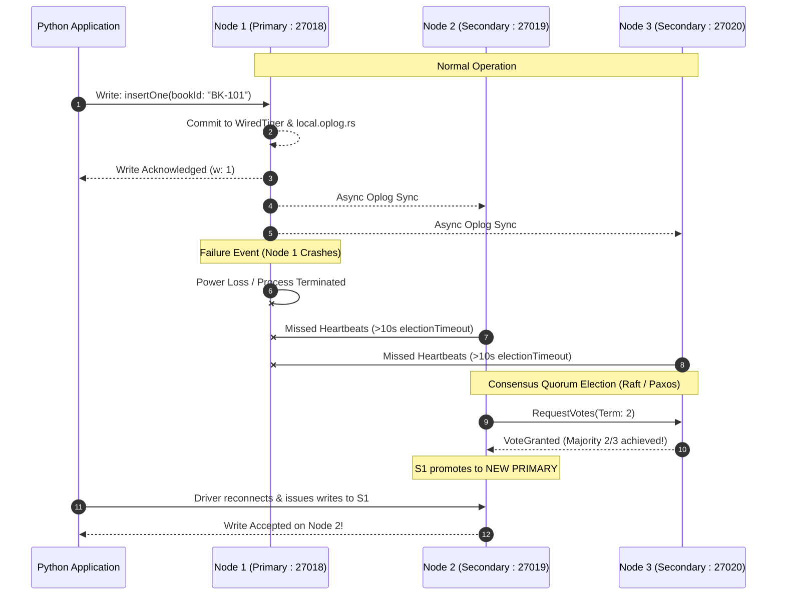
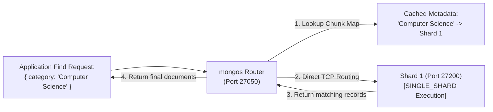
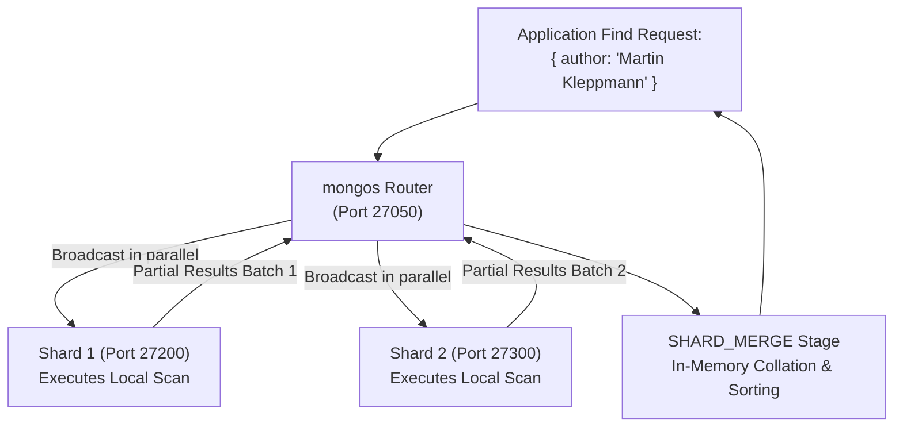

# DISTRIBUTED DATABASE ARCHITECTURE DIAGRAMS
## Implementation of Distributed Databases Using MongoDB: A Library Management System

---

## 1. Overall System Architecture

```mermaid
flowchart TD
    Client["Python CLI Application (app/main.py)"]
    
    subgraph StageA["STAGE A: 3-Node Replica Set (rs0)"]
        direction TB
        Node1["Node 1 (Port 27018)\n[PRIMARY]\nAccepts Writes & Reads"]
        Node2["Node 2 (Port 27019)\n[SECONDARY]\nOplog Replication"]
        Node3["Node 3 (Port 27020)\n[SECONDARY]\nOplog Replication"]
        
        Node1 -- "Oplog Stream" --> Node2
        Node1 -- "Oplog Stream" --> Node3
        Node1 <-->|Heartbeats (2s)| Node2
        Node2 <-->|Heartbeats (2s)| Node3
        Node1 <-->|Heartbeats (2s)| Node3
    end

    subgraph StageB["STAGE B: Production Sharded Cluster"]
        direction TB
        Router["mongos Query Router\n(Port 27050)"]
        Config["Config Server (cfg-rs)\n(Port 27100)\nStores Metadata & Chunks"]
        
        Shard1["Shard 1 (shard1-rs)\n(Port 27200)\nBooks: Computer Science, IT, Math"]
        Shard2["Shard 2 (shard2-rs)\n(Port 27300)\nBooks: Electrical, Mechanical, Physics"]
        
        Router <-->|Fetch Chunk Routing Table| Config
        Router -->|Targeted / Broadcast Queries| Shard1
        Router -->|Targeted / Broadcast Queries| Shard2
    end

    Client -.->|Default Connection (Stage A)| Node1
    Client -.->|Connection Mode Switch (Stage B)| Router
```

---

## 2. Stage A: Replica Set Fault Tolerance & Failover Mechanics



---

## 3. Stage B: Distributed Query Processing Architecture

### Scenario 1: Targeted Query Routing (High Efficiency)
When the filter contains the Shard Key prefix (`category`):



### Scenario 2: Scatter-Gather Broadcast Routing
When the filter searches on a non-shard key (`author` or `title`):



---

## 4. Shard Chunk Range Boundary Distribution

```
Collection: library_db.books
Compound Shard Key: { category: 1, bookId: 1 }

        Chunk 1 Range                      Chunk 2 Range                      Chunk 3 Range
[MinKey -> ("Computer Science", "BK-500")]  [("Computer Science", "BK-500") -> ("Math", MaxKey)]  [("Math", MaxKey) -> MaxKey]
                   │                                         │                                      │
                   ▼                                         ▼                                      ▼
             Stored on SHARD 1                         Stored on SHARD 1                      Stored on SHARD 2
             (Port 27200)                              (Port 27200)                           (Port 27300)
```
